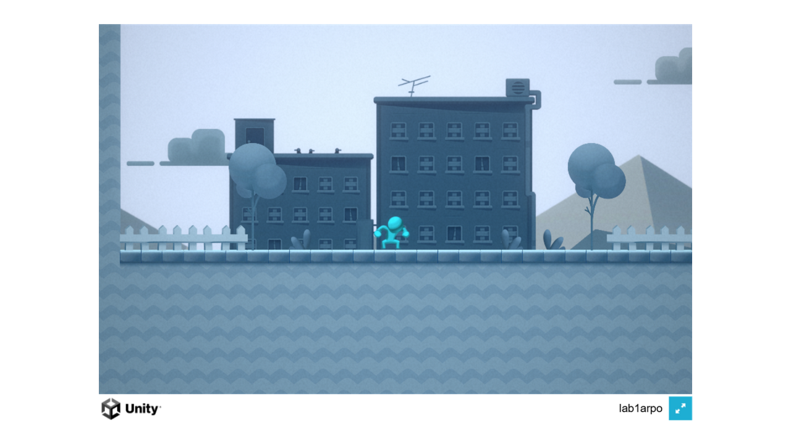
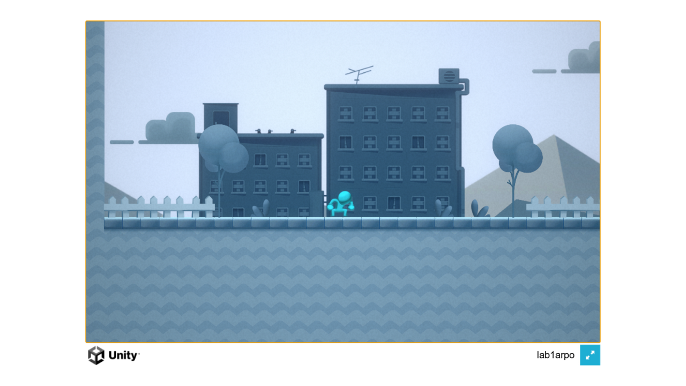

# Лабораторная работа №3. Контейнеризация веб-сервера в Docker и раздача сжатых файлов со стороны Nginx

Студент: Сергей Шнитко

Репозитории:
- https://github.com/temmie4real/arpolab3 (текущий)
- https://github.com/temmie4real/arpolab1 (ЛР №1, ЛР №2)
- https://github.com/temmie4real/arpolab2 (резервная копия из ЛР №2)

Цель работы: научиться упаковывать WebGL-сборку Unity 6 с включенным Gzip-сжатием в Docker-образ на базе Nginx, который корректно отдает сжатые архивы игры с HTTP-заголовком `Content-Encoding: gzip`, и автоматизировать сборку этого образа в GitHub Actions с публикацией в GitHub Container Registry (GHCR).

## Ход работы

### Шаг 1: Конфигурация сжатия в Unity 6 и локальная пересборка

В настройках проекта Edit → Project Settings → Player → WebGL → Publishing Settings включил формат сжатия **Gzip** (вместо Disabled, установленного в ЛР №1) и убедился, что галочка **Decompression Fallback** снята — задача лабораторной работы состоит в том, чтобы сжатые файлы корректно распаковывались веб-сервером, а не JS-распаковщиком на стороне клиента.

Фактические значения в файле `ProjectSettings/ProjectSettings.asset`:

```
webGLCompressionFormat: 1      (Gzip в Unity 6000.3.10f1)
webGLDecompressionFallback: 0  (резервная декомпрессия выключена)
```

Полностью закрыл редактор Unity и пересобрал проект через терминал командой из ЛР №1:

```
"D:\Unity versions\6000.3.10f1\Editor\Unity.exe" -batchmode -nographics
-projectPath "D:\programing_ucheba\sem7\unity\lab3arpo"
-executeMethod BuildManager.BuildWebGL -quit -logFile build_webgl.log
```

В логе сборки появилась строка `[CI/CD] УСПЕХ! WebGL билд успешно создан.` (время сборки 522 сек., размер 23 238 966 байт). В папке `Builds/WebGL/Build/` файлы игры сменили расширения на сжатые:

```
WebGL.data.gz
WebGL.framework.js.gz
WebGL.loader.js
WebGL.wasm.gz
```

### Шаг 2: Создание конфигурации веб-сервера nginx.conf

Создал в корне проекта файл `nginx.conf`. Конфигурация переопределяет стандартное поведение Nginx: для каждого типа сжатых архивов Unity добавляется принудительный заголовок `Content-Encoding: gzip` и корректный тип контента (`application/javascript` для `.js.gz`, `application/wasm` для `.wasm.gz`, `application/octet-stream` для `.data.gz`). Директива `try_files $uri $uri/ /index.html` гарантирует, что все запросы приложения попадут на `index.html`.

### Шаг 3: Создание файла Dockerfile

Создал в корне проекта файл `Dockerfile`. Образ собирается так: за основу берется ультра-легкий `nginx:alpine`, удаляется дефолтный `default.conf`, который не умеет работать с архивами Unity 6, вместо него копируется наш `nginx.conf`, а стандартная веб-папка `/usr/share/nginx/html` заменяется содержимым сжатой WebGL-сборки из `Builds/WebGL/`. Порт 80 объявлен как рабочий, Nginx запускается в режиме постоянного процесса (`daemon off;`).

### Шаг 4: Локальное тестирование контейнера

Собрал локальный образ и запустил контейнер с пробросом порта на 8080:

```
docker build -t platformer-compressed:v1 .
docker run -d -p 8080:80 --name unity_compressed_container platformer-compressed:v1
```

Размер готового образа — 140 МБ. Открыл `http://localhost:8080` в браузере — игра успешно загрузилась и работала:





Проверил заголовки сжатых файлов запросами `curl -I`:

```
=== wasm.gz ===
HTTP/1.1 200 OK
Content-Type: application/wasm
Content-Encoding: gzip

=== framework.js.gz ===
HTTP/1.1 200 OK
Content-Type: application/javascript
Content-Encoding: gzip

=== data.gz ===
HTTP/1.1 200 OK
Content-Type: application/octet-stream
Content-Encoding: gzip
```

Все три файла отдаются с кодом 200 и заголовком `Content-Encoding: gzip` — именно этого добивалась конфигурация Nginx.

Остановил тестовый контейнер:

```
docker stop unity_compressed_container && docker rm unity_compressed_container
```

### Шаг 5: Модернизация облачного пайплайна в GitHub Actions

Добавил в `.github/workflows/main.yml` задачу `build_docker_image`, которая зависит от `sanity_check` (`needs: sanity_check`) и имеет право публиковать пакеты (`permissions: packages: write`). Так как папка `Builds/WebGL` закрыта правилом `.gitignore`, на облачном раннере задача сначала создает временные файлы-заглушки (`touch Builds/WebGL/Build/game.*.gz`), чтобы шаг `COPY` в Dockerfile не упал без реального билда Unity (настоящая облачная компиляция будет подключена в ЛР №4–5). Затем задача логинится в `ghcr.io` через `docker/login-action@v3` и публикует образ с помощью `docker/build-push-action@v5` под двумя тегами: `latest` и привязанным к ревизии коммита `${{ github.sha }}`.

## Результаты

- Проект собирается через CLI со сжатием Gzip, образ `platformer-compressed:v1` локально протестирован — игра запускается, сжатые файлы отдаются с корректными заголовками.
- Пайплайн GitHub Actions собирает и публикует Docker-образ в GHCR: `ghcr.io/temmie4real/platformer-game:latest`.
